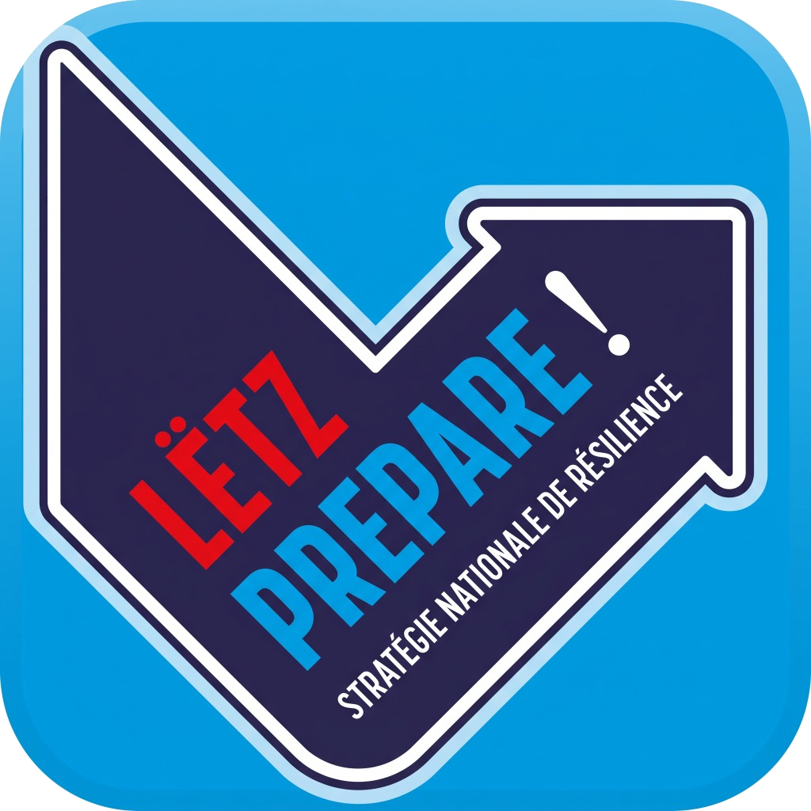

# Mon Guide 72h d'Autonomie — Lëtz prepare !

<p align="center">
  
</p>

<p align="center">
  <strong>Guide d'autonomie et de résilience civile 72 heures au Luxembourg</strong><br>
  Inspiré de la stratégie nationale <em>« Lëtz prepare ! »</em> du Gouvernement du Grand-Duché de Luxembourg
</p>

<p align="center">
  
  
  
  
  
  
  
</p>

---

## 📖 Présentation du Projet

En cas de crise majeure (panne électrique générale prolongée, inondations soudaines, tempêtes violentes ou accidents industriels), les réseaux mobiles, l'électricité et l'eau courante peuvent être interrompus pendant plusieurs jours.

**Mon Guide 72h d'Autonomie** est une application tout-en-un, **100% hors-ligne**, conçue pour permettre à chaque foyer résidant ou travaillant au Luxembourg de tenir en autonomie complète pendant au moins **72 heures** (3 jours) avant l'arrivée des secours massifs.

Tous les calculs, fiches médicales, plans d'urgence et sons de sirènes fonctionnent **sans aucune connexion internet**. Vos données personnelles restent exclusivement sur votre appareil.

---

## 🌟 Fonctionnalités Clés

### 📦 1. Calculateur de Kit de Survie 72h
* Calcul automatique et dynamique des besoins vitaux :
  * **Eau potable** : 3 litres par personne et par jour (boisson + hygiène minimale).
  * **Aliments non périssables** : rations sans cuisson complexe.
  * **Besoins spécifiques** : bébés (lait en poudre, couches) et animaux de compagnie (+1L eau/jour).
* Durée personnalisable (1 à 14 jours).

### 🎒 2. Checklist Sac d'Évacuation (*Bug-Out Bag*)
* Checklist interactive persistante pour préparer le départ immédiat en moins de 15 minutes.
* Sauvegarde automatique dans le stockage local de l'appareil.

### 📝 3. Plan d'Urgence Familial & Fiche Médicale ICE
* Répertoire de secours du foyer : identités, numéros CNS (matricule), points de ralliement (quartier et hors-ville).
* Emplacement des vannes de coupure d'urgence (gaz, électricité, eau).
* **Générateur de Fond d'Écran ICE (*In Case of Emergency*)** : Génère une image haute résolution (1080×2340 px) avec groupe sanguin, allergies critiques et contacts d'urgence consultable par le **112 / SAMU** sur l'écran verrouillé du smartphone.
* **Exportation A4 / PDF** d'un clic pour impression papier.

### 🔊 4. Simulateur de Sirènes Nationales (Synthèse Acoustique)
* Synthèse sonore mathématique hors-ligne (Web Audio API / AVAudioEngine / AudioTrack) sans fichier audio externe :
  1. **Essai Mensuel** (1er lundi du mois)
  2. **Alerte Incendie Pompiers**
  3. **Signal National d'Alarme (Danger Imminent)**
  4. **Fin d'Alarme**

### 🔦 5. Outils Tatiques Immédiats
* **Mode Blackout (OLED)** : Interface 100% noir absolu pour économiser drastiquement la batterie en coupure générale.
* **Mode Vision Nocturne (Rouge)** : Affichage monochromatique rouge pour préserver la rodopsina et la vision de nuit dans les abris.
* **Balise SOS en Code Morse** : Clignotement visuel calibré (`... --- ...`) pour signalisation nocturne aux hélicoptères de secours.
* **Lampe Écran & Lampe Torche Hardware**.

### 📻 6. Réseau Radio Résilient d'Urgence (FM / DAB+)
* Fréquences prioritaires au Luxembourg et en zones frontalières :
  * 🇱🇺 **RTL Radio Lëtzebuerg** : `88.9 MHz` (Dudelange / Sud) & `92.5 MHz` (Hosingen / Nord)
  * 🇱🇺 **Radio 100.7** : `100.7 MHz` (Radio Publique)
  * 🇱🇺 **Eldoradio** : `105.0 MHz` / `107.2 MHz`
  * 🇫🇷 **France Info** : `105.5 MHz`
  * 🇩🇪 **SWR3** : `98.5 MHz`
  * 🇧🇪 **RTBF La Première** : `96.4 MHz`

### 📅 7. Suivi des Péremptions du Kit (*Expiry Tracker*)
* Gestionnaire des dates limites pour l'eau, les conserves, les piles et les trousses de secours.
* Badges d'alerte automatiques (🟢 *Valide*, 🟡 *À renouveler <60j*, 🔴 *Périmé !*).

### 🌐 8. Support Multilingue Complet (7 Langues)
* 🇫🇷 Français (langue principale)
* 🇱🇺 Lëtzebuergesch (langue nationale)
* 🇩🇪 Deutsch
* 🇵🇹 Português (~20% des résidents au Luxembourg)
* 🇬🇧 English (EU / International)
* 🇪🇸 Español
* 🇮🇹 Italiano

---

## 🏗️ Architecture Multiplateforme

```
MonGuide72h/
├── index.html              # Application Web PWA principale
├── manifest.webmanifest    # Configuration PWA (standalone, orientation portrait)
├── sw.js                   # Service Worker Offline (Cache v2 complet)
├── js/
│   ├── app.js              # Logique métier, calculs, Web Audio, Canvas ICE
│   └── i18n.js             # Dictionnaire 7 langues
├── styles/
│   └── main.css            # Design System (tokens, blackout, vision nocturne, print A4)
├── assets/                 # Logotypes et icônes officielles
│
├── ios/                    # Application Native iOS (SwiftUI)
│   ├── MonGuide72h/        # Target principal iPhone & iPad
│   ├── MonGuide72hWatch/   # Extension autonome Apple Watch
│   ├── MonGuide72hWidget/  # Widgets Écran verrouillé & Home Screen
│   ├── MonGuide72h.xcodeproj
│   └── app_store_metadata.md # Fiche officielle de soumission App Store
│
├── android/                # Application Native Android (Kotlin + Compose)
│   ├── app/src/main/       # Écrans Material 3, ViewModels, AudioTrack
│   ├── build.gradle.kts
│   └── local.properties
│
└── AppStoreScreenshots/    # Captures d'écran calibrées pour l'App Store
```

---

## 🚀 Installation & Exécution

### 1. Web PWA
Aucun build ni dépendance requise. Ouvrez simplement `index.html` dans votre navigateur ou servez le dossier via n'importe quel serveur HTTP :
```bash
# Exemple avec Python
python3 -m http.server 8080
```
Pour installer sur smartphone :
* **iPhone (Safari)** : *Partager* ➔ *Sur l'écran d'accueil*.
* **Android (Chrome)** : *Menu* ➔ *Installer l'application*.

### 2. iOS (Xcode)
```bash
open ios/MonGuide72h.xcodeproj
```
* Sélectionnez la cible **Any iOS Device (arm64)** ou un simulateur iPhone 15/16.
* Pour soumettre à TestFlight : **Product** ➔ **Archive** ➔ **Distribute App**.

### 3. Android (Gradle / Android Studio)
```bash
cd android
./gradlew assembleDebug
```
L'APK prêt à tester sera généré dans `android/app/build/outputs/apk/debug/app-debug.apk`.

### 4. Automatisation CI/CD (GitHub Actions)
Le projet dispose de 3 workflows automatisés :
* **`deploy-pwa.yml`** : Déploiement automatique du Web PWA sur **GitHub Pages** (HTTPS) à chaque push sur `main`.
* **`android-ci.yml`** : Compilation continue de l'APK Debug et du Bundle Release (`app-release.aab`) avec téléversement automatique des artefacts.
* **`ios-ci.yml`** : Validation continue de la compilation du projet Xcode sur runner macOS.

---

## 🚨 Numéros d'Urgence au Luxembourg

| Service | Numéro | Description |
| :--- | :---: | :--- |
| **Secours & Pompiers (CGDIS)** | **112** | Urgences vitales, incendies, ambulances |
| **Police Grand-Ducale** | **113** | Urgences sécuritaires, accidents de la route |
| **Numéro Vert Info-Crise** | **8002 7788** | Informations gouvernementales en temps de crise |
| **Enfants Disparus (Europe)** | **116 000** | Ligne européenne d'assistance |
| **Médecin de Garde** | **112.lu** | Maisons médicales le soir et le week-end |

---

## 🔒 Confidentialité & Licence

* **Respect absolu de la vie privée** : Aucune donnée personnelle, médicale ou de localisation n'est transmise sur un serveur distant.
* **Conformité Apple Privacy** : Manifeste `PrivacyInfo.xcprivacy` validé sans pistage tiers.
* **Droits d'auteur** : © 2026 **InfoReis** ([inforeis.lu](https://inforeis.lu)). Tous droits réservés.
* **Sources de résilience** : Inspiré de la stratégie officielle *« Lëtz prepare ! »* du Ministère d'État et du Haut-Commissariat à la Protection nationale du Luxembourg.
